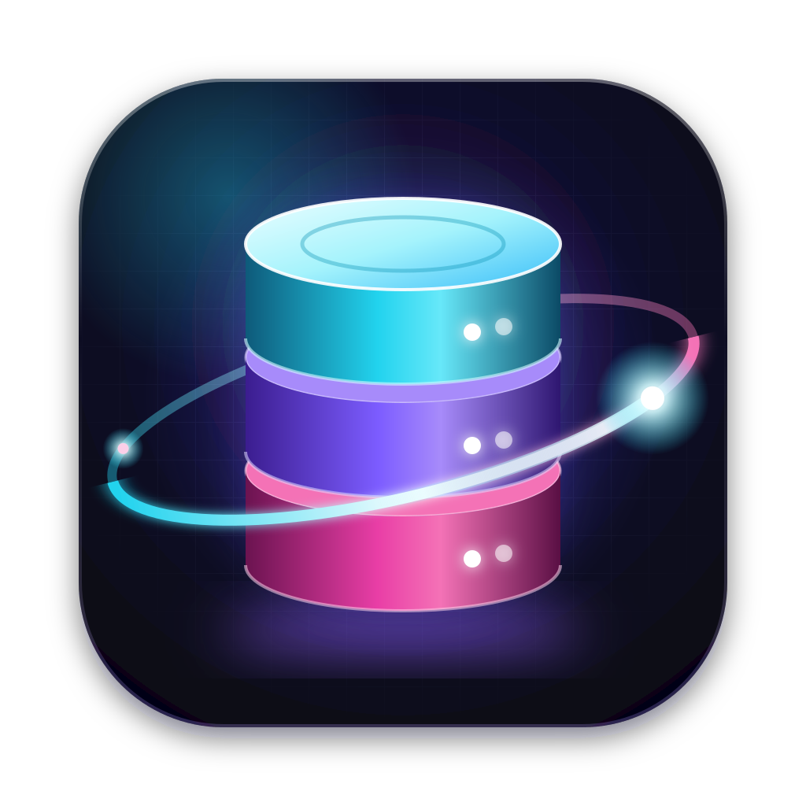
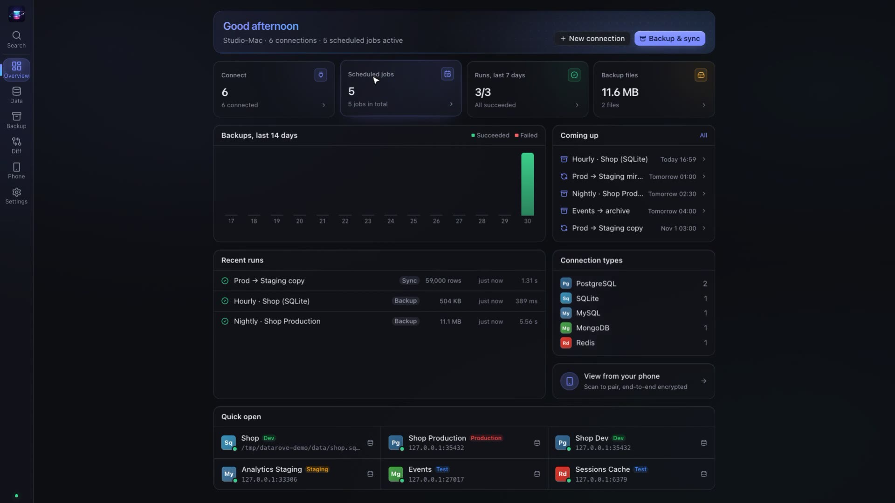
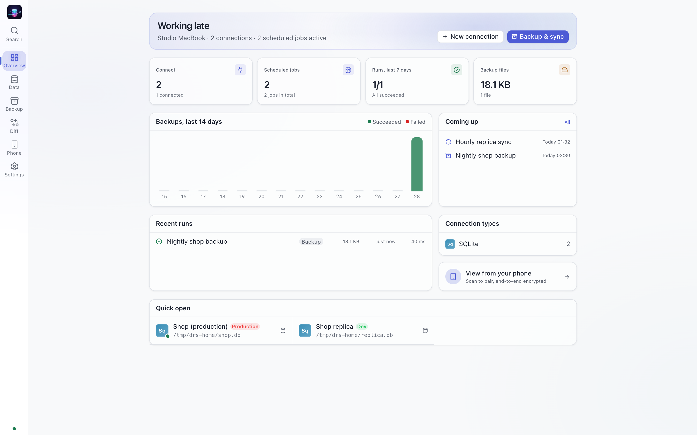
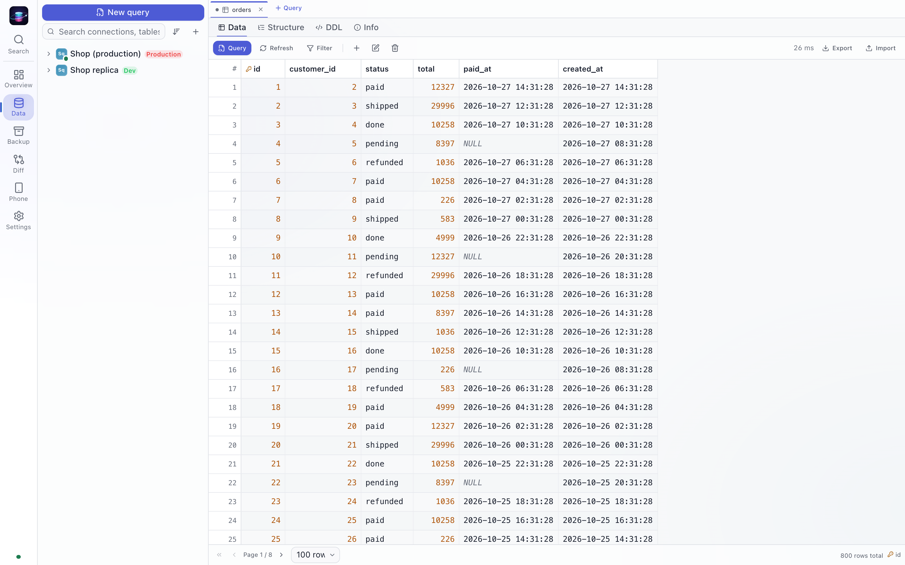
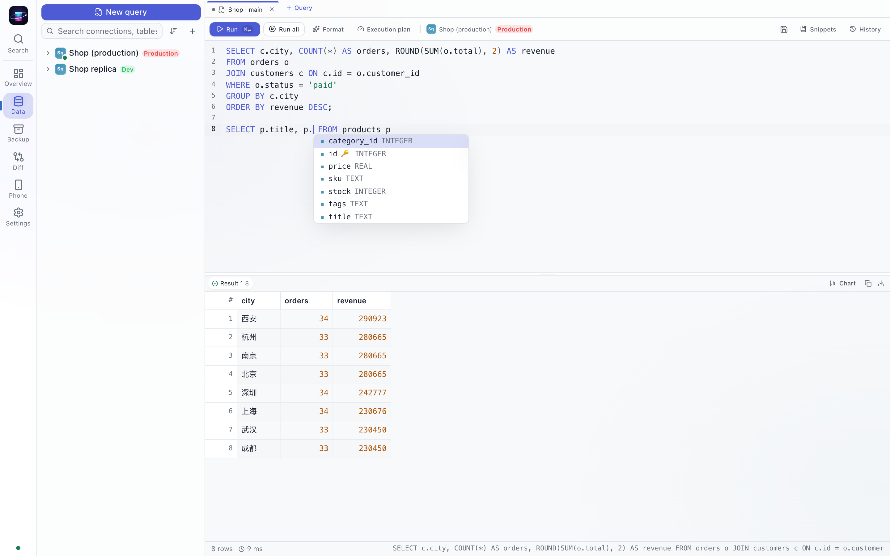
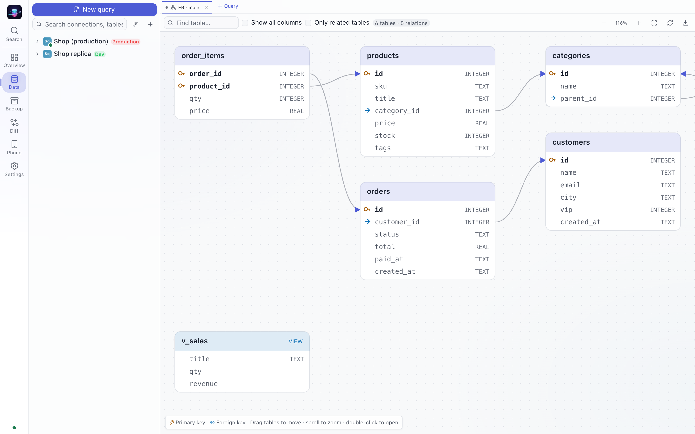
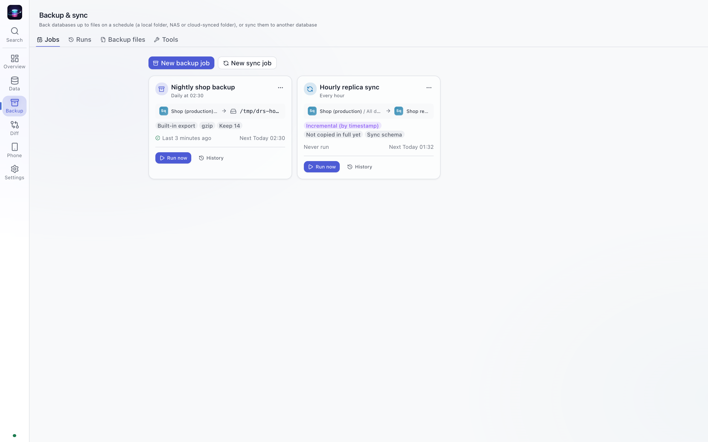
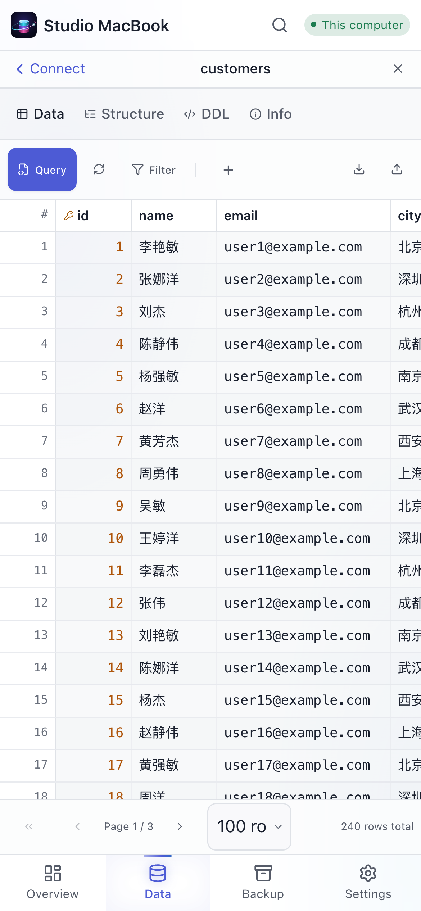

<h1 align="center">DataRove</h1>

<b>Gérez toutes vos bases de données depuis votre ordinateur et consultez-les depuis votre téléphone, avec un chiffrement de bout en bout.</b>

<a href="README.md">English</a> · <a href="README.zh-CN.md">简体中文</a> · <a href="README.zh-TW.md">繁體中文</a> · <a href="README.ja.md">日本語</a> · <a href="README.ko.md">한국어</a> · <a href="README.es.md">Español</a> · <b>Français</b> · <a href="README.de.md">Deutsch</a> · <a href="README.pt-BR.md">Português</a> · <a href="README.ru.md">Русский</a>

---

DataRove est un client de bases de données pour ordinateur, avec sauvegardes planifiées et synchronisation intégrées. Il tourne sur votre ordinateur (en application ou en service d’arrière-plan), et votre téléphone s’y connecte sur le réseau local ou via un relais. La connexion est chiffrée de bout en bout et les mots de passe des bases ne quittent jamais l’ordinateur.

**Bases de données :** MySQL · MariaDB · PostgreSQL · SQLite · SQL Server · MongoDB · Redis, avec tunnels SSH et TLS.

> **État :** 1.0.0. Les installeurs se téléchargent sur la page [Releases](../../releases) ; ensuite, les applications se mettent à jour d’elles-mêmes. Suivez ce dépôt (« Watch ») pour être averti des nouvelles versions. Historique dans le [CHANGELOG](CHANGELOG.md).

## Visite guidée en vidéo (4 minutes)

<a href="docs/video/DataRove-promo.mp4">Lire la vidéo</a> (MP4, 1080p, narration en anglais, sous-titres anglais et chinois) · sous-titres SRT : <a href="docs/video/DataRove-promo.en.srt">English</a>, <a href="docs/video/DataRove-promo.zh-CN.srt">简体中文</a>

## Fonctionnalités

### Parcourir et modifier les données
- Grille rapide à défilement virtuel avec filtres, tri et pagination. Modifiez une cellule sur place, ou ouvrez une ligne entière sous forme de formulaire, avec un champ adapté à chaque type de colonne (booléen, énumération, date, JSON, NULL / valeur par défaut).
- Pour une clé étrangère, cherchez dans la table référencée et choisissez une ligne.
- Prévisualisez le SQL exact avant d’enregistrer. Toutes les modifications sont validées dans une seule transaction et annulées ensemble en cas d’erreur. Les suppressions et les connexions de production demandent une confirmation.
- Copie en CSV / TSV / JSON / SQL / Markdown, export de fichiers, import CSV / JSON.

### Écrire des requêtes
- Éditeur SQL avec complétion selon le contexte : tables après `FROM` / `JOIN`, colonnes après `alias.`, listes de colonnes d’un `INSERT`, fonctions avec leur signature, modèles d’instructions.
- Survolez une table ou une colonne pour voir sa structure, ses types et ses commentaires. Les noms de table erronés, les `alias.colonne` inexistants et les `DELETE` / `UPDATE` sans `WHERE` sont soulignés avant l’exécution.
- Le résultat d’un `SELECT` sur une seule table qui inclut la clé primaire peut être modifié et enregistré directement.
- Syntaxe du shell MongoDB (`db.users.find({...})`) et ligne de commande Redis, toutes deux avec complétion.

### Comprendre le schéma
- Bases → tables / vues / collections → colonnes, index, clés étrangères, déclencheurs, DDL, nombre de lignes et taille.
- Diagramme ER, comparaison du schéma de deux bases avec SQL de migration généré, navigateur de clés Redis, moniteur du serveur (connexions, QPS, requêtes lentes).

### Importer et exporter
- Exportez une table ou un résultat filtré en CSV, TSV, JSON, JSON Lines, SQL `INSERT` ou Markdown ; importez du CSV / TSV / JSON / JSON Lines (UTF-8 et GBK sont reconnus).
- Les gros transferts s'exécutent en arrière-plan sur l'ordinateur, avec progression en direct et annulation. Les fichiers circulent par petits morceaux : une connexion coupée reprend au lieu de tout recommencer.
- Une importation se fait en une seule transaction : si une ligne échoue, rien n'est écrit et la ligne fautive est indiquée.

### Des sauvegardes fiables
- Sauvegarde dans des fichiers avec les outils natifs (mysqldump / pg_dump / mongodump) ou l’exportateur intégré, compression gzip et chiffrement AES-256-GCM, conservation des N derniers fichiers ou des N derniers jours.
- Chaque nouveau fichier est relu juste après son écriture (somme de contrôle, déchiffrement, analyse) : un fichier abîmé est repéré la nuit même.
- Synchronisation vers une autre base : remplacement complet, vidage puis chargement, ajout, upsert par clé primaire, ou synchronisation **incrémentale** via une colonne de repère (`updated_at`, identifiant auto-incrémenté…).
- Planification : toutes les N minutes, chaque jour, chaque semaine, chaque mois ou en cron. Les exécutions manquées sont rattrapées au démarrage. Notifications sur le bureau et par webhook. Restauration de n’importe quelle sauvegarde vers n’importe quelle connexion en un clic.
- La synchronisation fonctionne aussi entre types de bases (par exemple PostgreSQL → MySQL). Chaque table est écrite entièrement ou pas du tout, et le nombre de lignes est vérifié avant validation. Les erreurs temporaires sont réessayées automatiquement ; si certaines tables échouent encore, **ne réessayez que les parties en échec**. Les outils manquants (pg_dump, etc.) s'installent depuis l'application en un clic.

### Annuler une erreur
- Sur les connexions marquées *production*, DataRove enregistre les tables concernées avant un `UPDATE`, `DELETE`, `DROP`, `TRUNCATE`, une modification dans la grille, une importation qui écrase, une synchronisation ou une restauration.
- Annulez ensuite en un clic : seules les lignes différentes sont rétablies, en une transaction. Les instantanés sont chiffrés sur l'ordinateur.

### Votre téléphone, en toute sécurité
- La même interface sur votre téléphone. Scannez un QR code pour l’associer, sans compte.
- Chaque téléphone a un rôle (lecture seule, lecture-écriture ou administrateur) que vous pouvez modifier ou retirer à tout moment. Les droits temporaires expirent d’eux-mêmes, et un journal d’activité montre ce que chaque téléphone a fait.
- Sur le même Wi-Fi, le téléphone se connecte directement ; ailleurs, il passe par un relais qui ne transmet que du texte chiffré.

### Ordinateur
Reste dans la barre système, démarre à l’ouverture de session et peut s’installer en service d’arrière-plan (launchd / systemd / Planificateur de tâches Windows), pour que les sauvegardes planifiées continuent fenêtre fermée. 10 thèmes, clair et sombre, 15 langues d’interface.

## La sécurité en bref

- Les mots de passe enregistrés sont chiffrés sur l’ordinateur avec une clé maîtresse locale. L’interface et les téléphones associés ne voient que `••••`.
- L’association par QR code utilise un secret de 256 bits ; le code court saisi à la main est renforcé par scrypt. Chaque côté authentifie la clé de l’autre : un relais ne peut pas glisser son propre appareil.
- Chaque session utilise X25519 + ChaCha20-Poly1305 avec de nouvelles clés éphémères (confidentialité persistante). Les trames altérées, rejouées ou réordonnées sont rejetées, tout comme les tentatives de rétrogradation.
- Un relais public doit utiliser `wss://`. Vous pouvez héberger votre propre relais, et l’association peut se faire uniquement sur le réseau local.
- Tout ce qui sort du cadre de DataRove est réservé à l’ordinateur : chemins des outils, navigation dans les fichiers, accès aux fichiers SQLite, envoi d’un mot de passe enregistré vers un hôte modifié.

Pour signaler une vulnérabilité, consultez [SECURITY.md](SECURITY.md).

## Plateformes

| | |
|---|---|
| macOS | Apple Silicon et Intel |
| Windows | 10 / 11, x64 |
| Linux | AppImage, deb |
| Android | Application (compagnon d'un ordinateur, ou mode direct) |
| Téléphone | Tout navigateur mobile récent (installable comme application web) |

## Installation

Téléchargez le fichier pour votre système depuis la [dernière version](../../releases/latest). Chaque version indique les sommes SHA-256 dans `SHA256SUMS.txt`. Les installeurs ne sont pas encore signés avec un certificat de développeur Apple ou Microsoft ; le système demande donc une confirmation la première fois :

- **macOS** : ouvrez le `.dmg` et glissez DataRove dans Applications. Si macOS indique au premier lancement qu'il ne peut pas vérifier l'app, ouvrez **Réglages Système → Confidentialité et sécurité**, faites défiler et cliquez sur **Ouvrir quand même**. Si macOS indique que l'app est endommagée, exécutez `xattr -cr /Applications/DataRove.app` dans le Terminal, puis rouvrez-la.
- **Windows** : lancez le `.exe`. Si SmartScreen apparaît, cliquez sur **Informations complémentaires → Exécuter quand même**.
- **Linux** : rendez le `.AppImage` exécutable et lancez-le, ou installez le `.deb`.
- **Android** : ouvrez le `.apk` et autorisez l'installation depuis votre navigateur ou gestionnaire de fichiers. L'application s'associe à DataRove sur votre ordinateur ou, en mode direct, se connecte elle-même à vos bases de données (activez le téléphone une fois avec votre compte DataRove).

Connectez-vous ensuite dans l'application avec votre adresse e-mail et activez l'ordinateur. DataRove est gratuit ; aucune information de paiement n'est demandée.

## Licence, avertissement et versions

- DataRove est actuellement gratuit, avec toutes ses fonctionnalités. Aucune information de paiement n'est demandée.
- DataRove est un logiciel propriétaire, pas un logiciel libre. L'utilisation de l'application est régie par le Contrat de licence utilisateur final, la Politique de confidentialité et les Conditions d'achat affichés au premier démarrage, que vous acceptez dans l'application. Voir [LICENSE.md](LICENSE.md) (le texte anglais fait foi).
- DataRove modifie de vraies bases de données. Conservez des sauvegardes indépendantes et testées, et lisez l'[avertissement](DISCLAIMER.md).
- Les versions suivent le [Versionnage sémantique](https://semver.org/lang/fr/). Chaque version détaille ses changements dans [CHANGELOG.md](CHANGELOG.md) et fournit un `SHA256SUMS.txt`.

## Retours

Signalez les bugs et proposez des idées dans les [Issues](../../issues). Ce dépôt contient les notes de version et les installeurs ; le code source n’est pas public.
